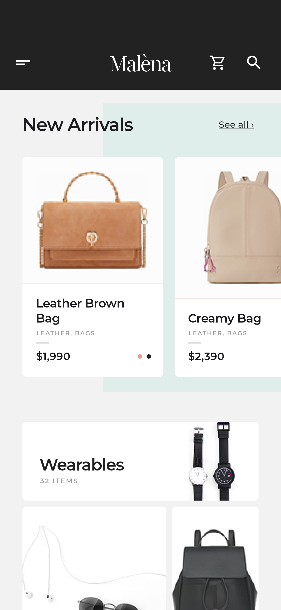
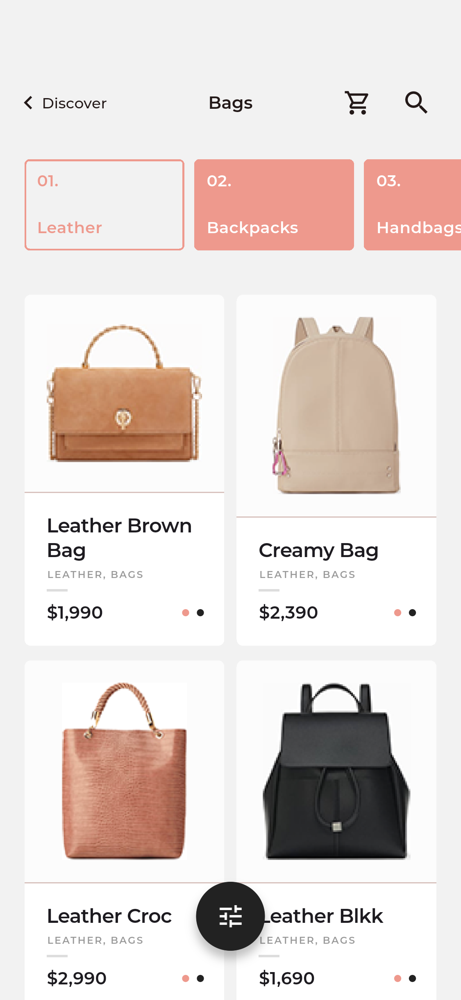
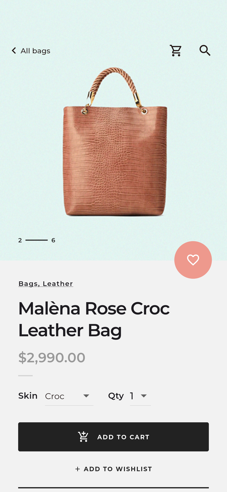
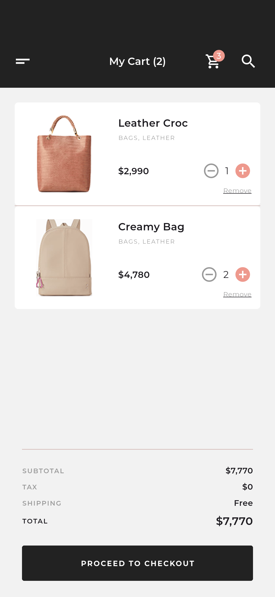
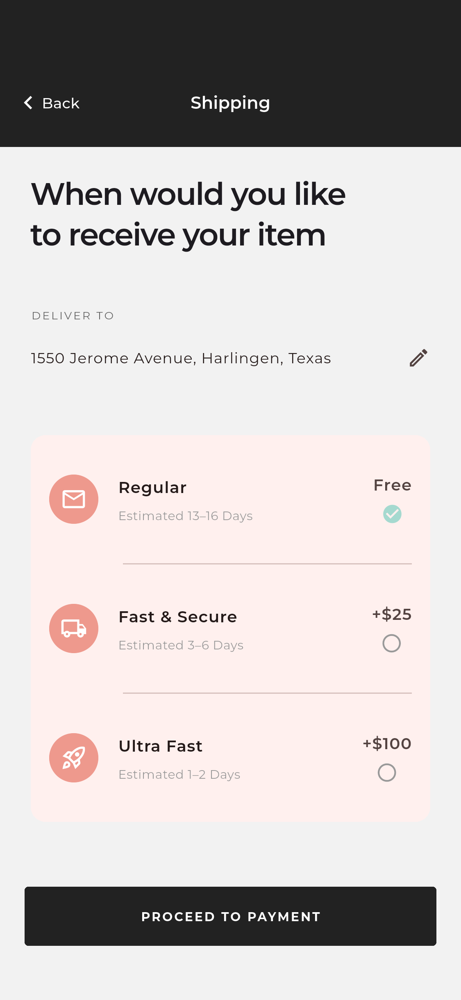
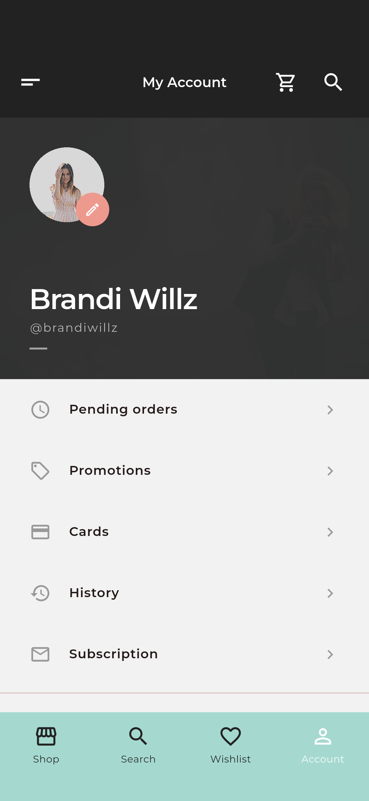
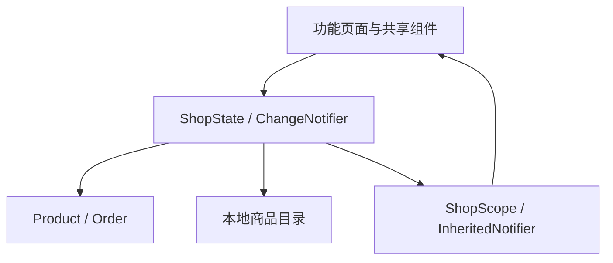

# Malèna Flutter 项目说明

## 1. 项目概览

Malèna 是一款精品时尚购物应用。本项目读取 Pixso 当前打开的「Malèna」设计文件，参考其中 22 个页面，实现从欢迎、登录、浏览商品、筛选、收藏、加入购物车，到配送、演示支付、订单完成及账户查看的完整本地流程。

设计沿用黑白底色、珊瑚粉操作色、浅青色图片背景，以及 Montserrat 正文字体和 Playfair Display 品牌字体。商品与摄影素材直接来自用户提供的 Pixso 设计。界面文案保持原稿的英文，工程说明使用中文。

这是可运行的 UI 与交互演示工程。认证、支付、扫码、地图和通知均未连接生产服务。购物车、收藏、订单与设置为会话内状态；重启应用后恢复演示数据。

## 2. 主要界面

以下图片来自 Android 模拟器运行截图；全部 22 个界面及长页补充截图见 [截图索引](SCREENSHOTS.md)。`design/` 目录另存 Pixso 原稿，便于对照。

### 浏览与选购

| 发现页 | 商品分类 | 商品详情 |
| --- | --- | --- |
|  |  |  |

发现页展示新品、主题系列与分类入口；分类页支持材质分组和筛选；详情页提供数量选择、收藏、加入购物车、规格展开与评价入口。

### 购物与账户

| 购物车 | 配送选择 | 个人账户 |
| --- | --- | --- |
|  |  |  |

购物车支持增减数量和移除，金额按商品价格实时计算。配送方式影响结账总额。订单完成后会清空购物车，并可在账户的 Pending orders / History 中查看本次运行的订单。

## 3. 页面与交互范围

| 模块 | 页面 | 已实现交互 |
| --- | --- | --- |
| 进入应用 | Splash、Login、Sign up、Slider | 访客进入、登录校验、注册邮箱确认及条款勾选、进入商店 |
| 浏览 | Discover、Sidelist、Category、Filters | 横向新品卡、系列入口、侧栏路由、分组、类别/颜色/价格/评分筛选及重置 |
| 商品 | Product、Reviews | 商品数据绑定、数量与皮革选项、加入购物车、收藏切换、规格折叠、评价列表 |
| 交易 | Cart Empty、Cart、Shipping、Payment、Done | 数量调整、移除、空态、配送费用、编辑地址、演示卡校验、生成本地订单 |
| 探索 | Search、Search results、Wishlist | 关键词搜索、推荐词、空结果提示、收藏列表和移除 |
| 门店 | Map、Scan | 原稿静态地图、复制门店地址、示例码跳转商品 |
| 账户 | Account、Settings | 订单查看、优惠说明、账户资料修改、深色模式、订阅与通知偏好切换 |

交互补充遵循现有视觉：搜索不再展示原稿中与商品无关的固定查询结果；购物车和支付页共享实际金额；配送页增加可编辑的演示地址；扫码页明确提供示例码入口。原稿中的部分错字和遮叠文案已修正。系统状态栏、Material 图标和平台控件会随设备呈现，未做逐像素静态图复刻。

## 4. 项目结构

```text
malena/
├── lib/
│   ├── main.dart                     # 启动入口
│   ├── app.dart                      # 应用装配、主题监听、路由分发
│   ├── core/
│   │   ├── routes.dart               # 22 个页面枚举与导航辅助方法
│   │   └── theme.dart                # 色彩、字体、表单和控件主题
│   ├── models/product.dart           # Product、Order、金额格式化
│   ├── data/catalog.dart             # 本地商品目录
│   ├── state/shop_state.dart         # 会话状态和购物业务规则
│   ├── ui/components.dart            # 页头、底栏、按钮、商品卡、空态等
│   └── features/
│       ├── auth/auth_pages.dart      # 欢迎、登录、注册、系列引导
│       ├── shop/discover_page.dart   # 发现页、订阅区、侧栏
│       ├── shop/catalog_pages.dart   # 分类、筛选、详情、评价
│       ├── checkout/checkout_pages.dart # 购物车、配送、支付、完成
│       ├── explore/explore_pages.dart  # 搜索、收藏、门店、扫码
│       └── account/account_pages.dart  # 账户、设置与订单查看
├── assets/
│   ├── images/                       # Pixso 导出的本地图片
│   └── fonts/                        # 两套字体及 OFL 授权文件
├── android/                          # Android 宿主工程
├── ios/                              # iOS 宿主工程
├── web/                              # Web 宿主工程
├── test/                             # 状态、表单和小屏布局测试
├── integration_test/app_test.dart    # 模拟器完整流程与截图用例
├── test_driver/screenshots.dart      # 集成测试驱动
├── tool/capture_screenshots.sh       # 运行测试并导出模拟器截图
├── docs/
│   ├── PROJECT.md                    # 本文
│   ├── SCREENSHOTS.md                # 全部界面与 Pixso 节点对应表
│   ├── screenshots/                  # 应用实机渲染截图
│   └── design/                       # 22 张 Pixso 原稿导出图
├── artifacts/                        # ARM64 Android 演示安装包
└── pubspec.yaml
```

## 5. 架构与数据流

采用按功能组织的轻量分层结构，生产代码只依赖 Flutter SDK。



### 应用与路由

`main.dart` 只负责初始化和启动。`MalenaApp` 创建并持有 `ShopState`，通过 `ShopScope` 向下提供状态，并监听深色模式变化。`AppPage` 是唯一页面枚举；路由统一在 `app.dart` 映射，避免字符串散落。

欢迎流程结束后清除先前路由，底部主导航切换时回到相应模块根页，商品等次级界面使用栈式导航。返回时没有上级页面则回到发现页，避免进入无返回目标的空白状态。

### 状态与业务规则

`ShopState` 管理购物车、收藏、当前商品、查询与筛选条件、用户资料、配送方式和订单。购物车对外提供不可修改的视图，所有数量变更通过明确的方法完成。

- 购物车以商品 ID 关联目录，单品数量限制为 1–99，减到 0 自动移除。
- 小计由单价和数量计算；总额 = 小计 + 配送费。本地演示税费为 0。
- Regular / Fast & Secure / Ultra Fast 的配送费为 0 / 25 / 100 美元。
- 下单先冻结总额、件数、配送方式和日期，再清空购物车，避免订单金额被后续状态覆盖。
- 搜索忽略首尾空格和大小写，匹配名称、类别和材质。
- 筛选根据类别、示例颜色映射、价格区间和最低评分共同计算。

页面中的表单输入、折叠状态、商品数量选择等临时 UI 状态保留在局部 `StatefulWidget` 中。共享购物数据留在 `ShopState`，使返回页面和跨模块导航保持一致。

### 数据与服务边界

商品目录为 8 件演示商品。金额使用整数美元，避免在此数据规模下引入浮点累计误差。正式接入多币种时建议改为最小货币单位并增加币种信息。

后续接入后端时，可把目录、订单、认证和设置持久化分别替换为 Repository。现有页面消费的数据模型和状态方法可以保留；不需要在每个 Widget 中直接调用网络接口。

可直接安装 [Android ARM64 演示包](../artifacts/malena-android-arm64.apk)，安装说明见 [artifacts/README.md](../artifacts/README.md)。

## 6. 运行方式

环境：Flutter 3.41.6 stable，Dart 3.11.4。

```bash
flutter pub get
flutter devices
flutter run -d emulator-5554
# 或在浏览器运行
flutter run -d chrome
```

Android 模拟器需提前启动；设备 ID 以 `flutter devices` 为准。iOS 工程可使用 Xcode 打开 `ios/Runner.xcworkspace`，在有可用运行时的模拟器或已配置签名的真机上运行。

演示登录填写任意非空用户名和至少 6 位密码即可；注册额外校验邮箱一致性和条款勾选，也可直接使用欢迎页的访客入口。此流程不会创建远程账户。

支付页点击 **Use demo card** 填入 `4242 4242 4242 4242`、`12/30` 和 `123`。支付完成仅创建本地演示订单；PayPal 和 Apple Pay 选项同样属于演示。

## 7. 验证与截图复现

```bash
flutter analyze
flutter test
./tool/capture_screenshots.sh emulator-5554
flutter build apk --release
flutter build web --release
```

截图脚本在 Android 模拟器执行实际页面和购买流程，通过 Flutter 集成测试截图接口生成 PNG，再从应用自己的缓存目录导出到 `docs/screenshots/`。图片文件不通过 VM 服务以大数组集中返回，避免高分辨率多页截图使驱动连接中断。该缓存导出方式依赖 debug 包的 `run-as`，仅用于开发测试。

验证记录见 [VALIDATION.md](VALIDATION.md)。截图覆盖 22 个原稿页面，并额外记录发现页长内容、商品规格和深色设置页。原稿与应用截图使用相同编号，便于查找。

## 8. 代码精简与维护

完成页面后，已移除 Pixso 生成的绝对定位组件、适配工具及无效 localhost 图片依赖，改为共享页头、按钮、商品卡、商品行、空态、数量控件和金额汇总。素材随应用打包，无运行时网络图片依赖。

没有为本地 UI 演示引入路由、状态管理或网络第三方库。功能页面按模块聚合，避免为单个简单部件建立过多文件。文本控制器、应用持有的状态均在相应生命周期释放。验证脚本和截图留在开发目录，不参与业务逻辑。

目前的持久化边界是一次应用运行：登录资料、购物车、收藏、设置与订单不会跨进程保存。相机扫码、动态定位地图、推送注册、真实认证、支付网关和订单提交需要在后续服务接入阶段实现。
