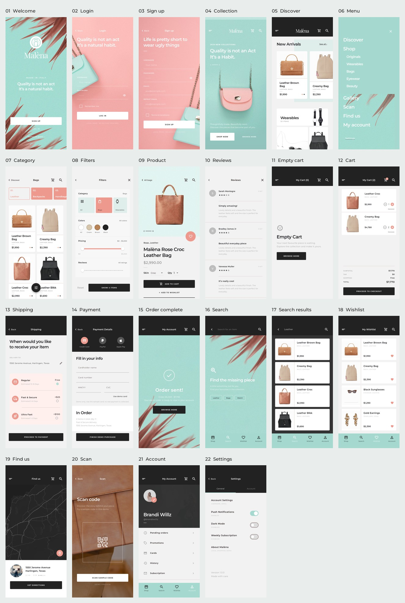

# 全部界面截图

所有 `screenshots/` 图片均由 Android 模拟器运行 Flutter 应用生成；`design/` 图片为 Pixso 原稿导出。



## 页面对应表

| 编号 | 页面 | Pixso 节点 | 应用截图 | 参考原稿 |
| --- | --- | --- | --- | --- |
| 01 | 欢迎页 · Splash | `0:1989` | [查看](screenshots/01-splash.png) | [对照](design/01.png) |
| 02 | 登录 · Login | `0:1929` | [查看](screenshots/02-login.png) | [对照](design/02.png) |
| 03 | 注册 · Sign up | `0:1860` | [查看](screenshots/03-signup.png) | [对照](design/03.png) |
| 04 | 系列引导 · Slider | `0:1802` | [查看](screenshots/04-editorial.png) | [对照](design/04.png) |
| 05 | 发现 · Discover | `0:1621` | [查看](screenshots/05-discover.png) | [对照](design/05.png) |
| 06 | 侧栏菜单 · Sidelist | `0:1569` | [查看](screenshots/06-menu.png) | [对照](design/06.png) |
| 07 | 商品分类 · Category | `0:1442` | [查看](screenshots/07-category.png) | [对照](design/07.png) |
| 08 | 筛选 · Filters | `0:1299` | [查看](screenshots/08-filters.png) | [对照](design/08.png) |
| 09 | 商品详情 · Product | `0:1167` | [查看](screenshots/09-product.png) | [对照](design/09.png) |
| 10 | 评价 · Reviews | `0:1088` | [查看](screenshots/10-reviews.png) | [对照](design/10.png) |
| 11 | 空购物车 · Cart (Empty) | `0:1031` | [查看](screenshots/11-cart-empty.png) | [对照](design/11.png) |
| 12 | 购物车 · Cart | `0:939` | [查看](screenshots/12-cart.png) | [对照](design/12.png) |
| 13 | 配送信息 · Shipping info | `0:844` | [查看](screenshots/13-shipping.png) | [对照](design/13.png) |
| 14 | 支付详情 · Payment details | `0:752` | [查看](screenshots/14-payment.png) | [对照](design/14.png) |
| 15 | 订单完成 · Done | `0:697` | [查看](screenshots/15-done.png) | [对照](design/15.png) |
| 16 | 搜索 · Search | `0:623` | [查看](screenshots/16-search.png) | [对照](design/16.png) |
| 17 | 搜索结果 · Search results | `0:529` | [查看](screenshots/17-search-results.png) | [对照](design/17.png) |
| 18 | 收藏 · Wishlist | `0:401` | [查看](screenshots/18-wishlist.png) | [对照](design/18.png) |
| 19 | 门店地图 · Map | `0:301` | [查看](screenshots/19-map.png) | [对照](design/19.png) |
| 20 | 示例扫码 · Scan | `0:256` | [查看](screenshots/20-scan.png) | [对照](design/20.png) |
| 21 | 个人账户 · Account | `0:60` | [查看](screenshots/21-account.png) | [对照](design/21.png) |
| 22 | 设置 · Settings | `0:2` | [查看](screenshots/22-settings.png) | [对照](design/22.png) |

## 长页和状态补充

- [发现页：系列与分类](screenshots/05b-discover-collections.png)
- [发现页：邮件订阅](screenshots/05c-discover-newsletter.png)
- [商品详情：规格与说明](screenshots/09b-product-details.png)
- [设置：深色模式](screenshots/22b-settings-dark.png)

## 截图环境

- Android API 35，Kino_API_35 模拟器。
- 设备分辨率设置为 1125 × 2436，density 480，对应 375 × 812 逻辑像素。
- 截图由 Flutter IntegrationTestWidgetsFlutterBinding 生成，保留原始 PNG。
- 01–22 为主页面，补充共 4 张，总计 26 张应用截图；两张 JPG 为这些截图的缩略拼图。
- 购物车示例包含 1 件 Leather Croc 与 2 件 Creamy Bag；小计 $7,770，快递费 $25，演示订单总额 $7,795。
- 原稿的 Discover / Product 是长画板；应用中以可滚动页面呈现。

## 重新生成

```bash
./tool/capture_screenshots.sh emulator-5554
# 可选：需要本机 Python 安装 Pillow，仅用于生成总览拼图
python3 tool/make_gallery.py
```

截图用例会执行登录、浏览、加入购物车、配送选择、演示支付、搜索和扫码跳转，并断言金额、订单记录与页面状态。页面总览通过统一路由进入相应页面，便于稳定复现。
